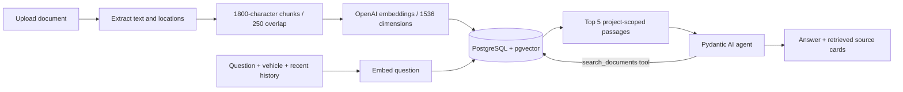

# Gruz LLM

A bilingual garage assistant for old-car repair and restoration. Create a vehicle project, add workshop documents, and ask questions backed by semantic search and inspectable sources.

## Start with Docker

Prerequisites: Docker Desktop with Linux containers.

```powershell
Copy-Item .env.example .env
# Edit .env and set OPENAI_API_KEY
docker compose up --build -d
```

Open [Gruz LLM](http://127.0.0.1:5173). API documentation: [Swagger UI](http://127.0.0.1:8000/docs).
You can create projects and explore the UI without an API key. Uploading/indexing and chatting require your own OpenAI API key with API billing; a ChatGPT subscription does not provide API credits.

The services bind to loopback. This MVP is a **single-user local application without authentication**. Add authentication, authorization, quotas, and production secret handling before exposing it to a network. The database password in Compose is for local development.

```powershell
docker compose logs -f backend
docker compose down
```

PostgreSQL and original uploads persist in Docker volumes. `docker compose down` preserves them. Deleting a project in the application permanently deletes its chats, documents, and embeddings.

## Local development

Requirements: Python 3.12+, uv, Node.js 22+, Docker Desktop.

```powershell
docker compose up -d db
cd backend
uv sync --frozen
uv run alembic upgrade head
uv run uvicorn app.main:app --reload --host 127.0.0.1 --port 8000
```

In a second terminal:

```powershell
cd frontend
npm ci
npm run dev
```

Vite proxies `/api` to FastAPI. Production uses Nginx with the same origin. Backend settings load `.env` from the repository root or backend directory; environment variables take precedence. After changing Compose environment values, recreate the backend with `docker compose up -d --force-recreate backend`.

## What is included

- React, TypeScript, Tailwind CSS, Zustand, Lucide; responsive ChatGPT-style interface.
- English and Polish UI and answer-language selection; locale and active-project preference persist locally.
- Car switcher with up to five recently used projects, a searchable garage gallery, and a conversation shortcut beside the sidebar heading.
- Dedicated document workspace with list/grid layouts, filename search, and metadata in an on-demand details panel.
- Vehicle setup with make/model suggestions, custom entries, year, engine, and project name.
- Separate document libraries and persistent conversations per vehicle project.
- PDF (text), DOCX paragraphs/tables, XLSX sheets, UTF-8 TXT/MD/CSV ingestion.
- Closable document previews: original PDF pages with zoom and page navigation, formatted DOCX text/tables, and XLSX/CSV grids with sheet tabs and paging. Chat sources open the reader beside the source drawer, jump to the cited page or sheet, and blink matched text in green for five seconds. A jump-to-citation control repeats the highlight; unmatched text is reported explicitly.
- Upload status, indexing errors, original-file downloads, deletion, source excerpts and locations.
- FastAPI, SQLAlchemy, Alembic, PostgreSQL 17, and pgvector with a cosine HNSW index.
- Pydantic AI agent with a `search_documents` tool, bounded tool calls, conversation history, and vehicle context.
- Immediate outgoing messages, a locked composer during generation, and live agent activity over server-sent events.
- Persisted execution details: search queries, retrieved passages/scores, tool arguments/results, model calls, timing, usage, and failures. These are observable actions, not hidden model reasoning.
- Accepted streamed turns survive a disconnected browser. Refreshing resumes status polling; interrupted runs are marked failed on server restart.

## Retrieval pipeline



Default models: `openai:gpt-4.1-mini` for generation and `text-embedding-3-small` for embeddings. The generation agent uses Pydantic AI; embeddings use the OpenAI SDK with batched requests. Configure model names in `.env`. Only OpenAI chat models are wired in this MVP. Embeddings are fixed at 1536 dimensions; changing embedding models requires re-indexing every document, even when dimensions match.

Retrieval is restricted to the selected project in both the initial search and the agent's tool. The assistant sees the latest 20 messages. Source cards show retrieved evidence; they are not a guarantee that every generated claim is supported. Verify retrieval and factual correctness on your own manuals before relying on specifications. Scanned PDFs require OCR externally; diagrams/images are not interpreted. XLSX reads cached formula values, not recalculated formulas.

Documents are limited to 20 MB, 1,000 PDF pages, and 2,000 chunks. DOCX/XLSX expanded archives are limited to 80 MB. Indexing and generation use in-process tasks, so run one backend worker. Interrupted jobs are marked failed on restart. A durable job queue, OCR, auth, observability and retrieval evaluation are good next steps. Uploaded text and questions are sent to OpenAI; originals stay in the upload volume. No public vehicle catalog is queried; suggestions are a small editable starter list.

The UI posts to `/api/chats/{id}/messages/stream`. An `accepted` event contains the saved user message and assistant placeholder; `activity` events contain timestamped execution records; `complete` or `failed` ends the stream. Generation runs independently of the HTTP connection with a 120-second timeout. The JSON endpoint `/api/chats/{id}/messages` remains available and saves a successful turn atomically. Execution records and retrieved excerpts are stored in PostgreSQL alongside each assistant message; older messages have no recorded trace.

## Checks

The integration suite needs a migrated local PostgreSQL instance. It creates and cleans up its own test projects and uses deterministic fake embeddings plus Pydantic AI's `TestModel`; it makes no paid AI requests.

```powershell
cd backend
uv run ruff check .
uv run ruff format --check .
uv run pytest
cd ../frontend
npm run build
```

Backend linting and formatting are enforced in CI with Ruff (Python 3.12, 88-character lines, sorted imports, and double quotes). To apply automatic lint fixes and format all backend Python files, run these commands from `backend`:

```powershell
uv run ruff check --fix .
uv run ruff format .
```

The tests exercise project isolation, parsing, indexing, real pgvector retrieval, agent tool use, message persistence, deletion cascades, invalid uploads, missing configuration and provider failures. A real paid-provider smoke test still requires your API key.
